<div align="center">

# 🎬 Cinema Night

**Online seat booking for an open-air movie night in Almaty.**

Visitors pick seats on an interactive hall map, an operator confirms the booking
by phone, and the visitor gets a PDF ticket with a QR code that is checked at the
entrance. Everything runs on a small handwritten PHP MVC framework.


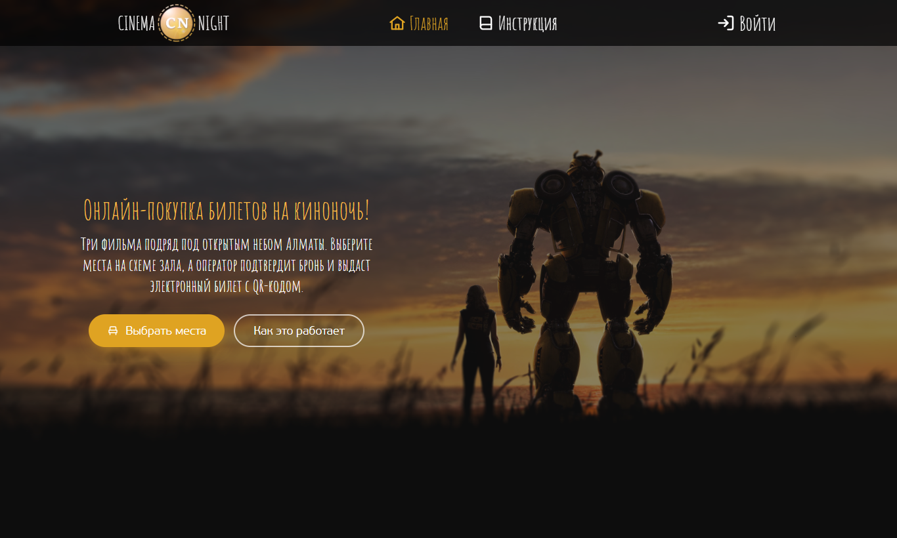

</div>

---

## ✨ Features

**For visitors**

- 🔐 Sign up and sign in with password hashing and helpful validation messages
- 🪑 Interactive hall map (11 rows × 16 seats) showing free, selected and taken
  seats, with a live counter of seats and total price
- 📨 Booking requests: seats are held right away, so two people can't book the
  same seat
- 🎟 "My tickets": request status, seats and price. Confirmed bookings open as a
  **PDF ticket with a QR code**
- 👤 Profile with name and phone, so the operator can call back

**For the operator**

- 📋 Incoming requests with the visitor's name, a tap-to-call phone number, seats
  and total, plus **Confirm** / **Reject** buttons
- 🎫 List of issued tickets with links to the PDF and the check page
- 📱 **Entrance check**: scan the QR code on the ticket, see the ticket details
  and mark it as used with one tap. A ticket can't be used twice

## 📸 Screenshots

| Hall map | Operator: booking requests |
| :---: | :---: |
| 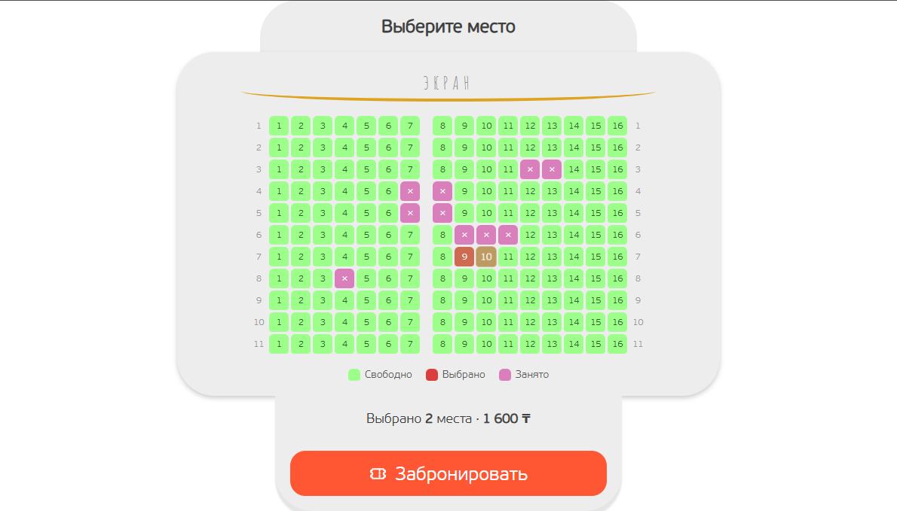 | 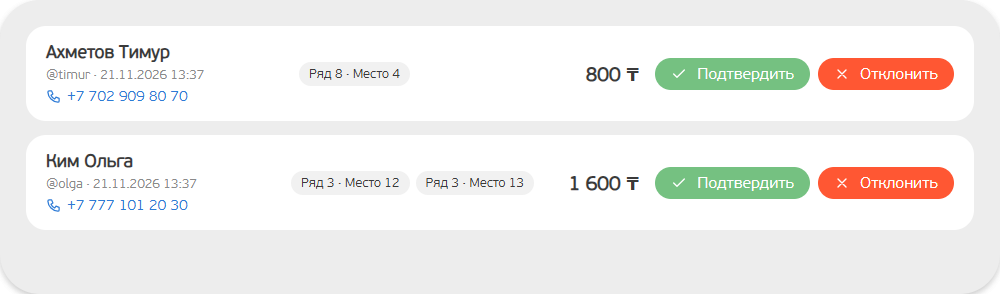 |
| **PDF ticket** | **Entrance check (after scanning the QR code)** |
| 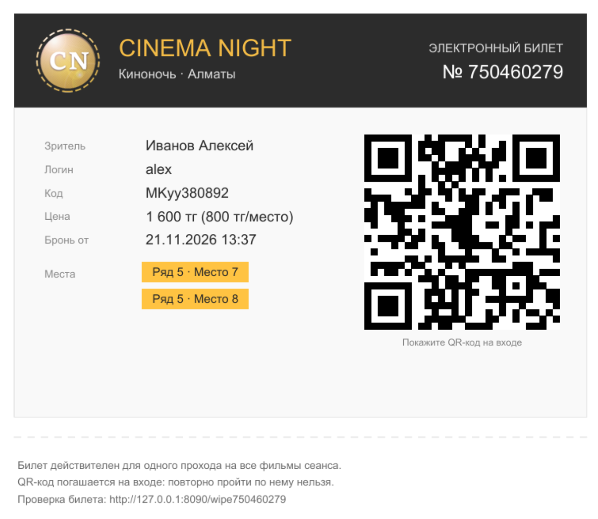 | 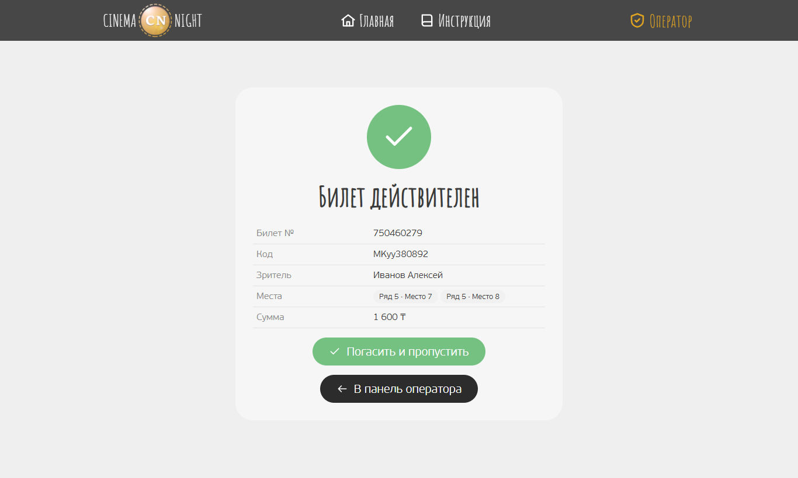 |

<details>
<summary>More screenshots</summary>

| How it works | Program of the night |
| :---: | :---: |
| 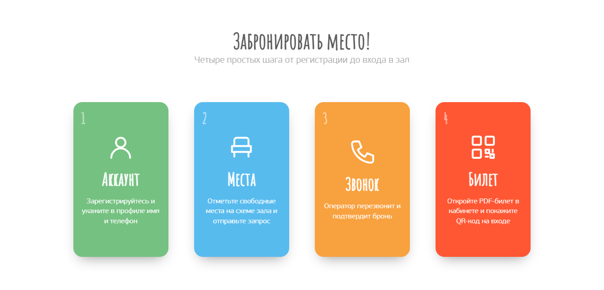 | 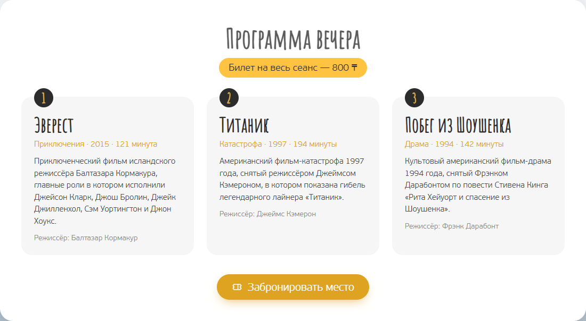 |
| **Sign in** | **Used ticket** |
| 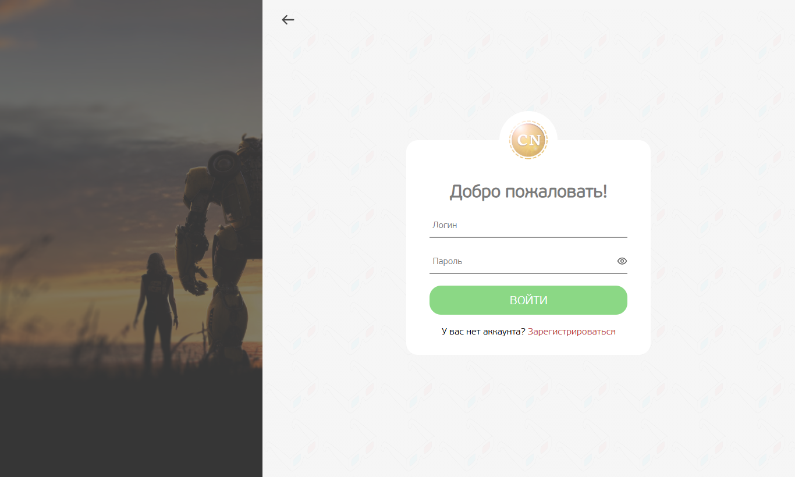 | 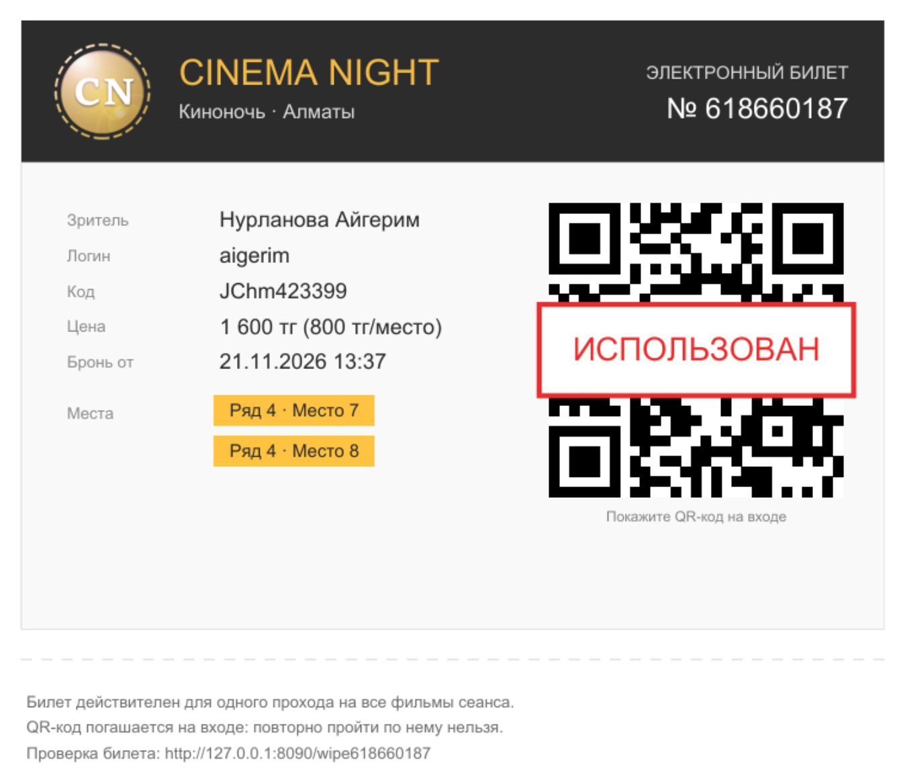 |
| **My tickets: pending / confirmed** | **Operator: issued tickets** |
| 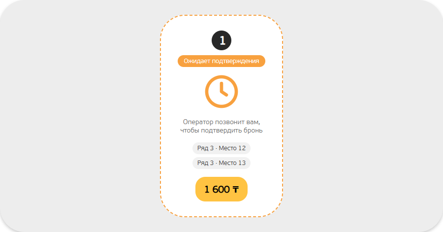 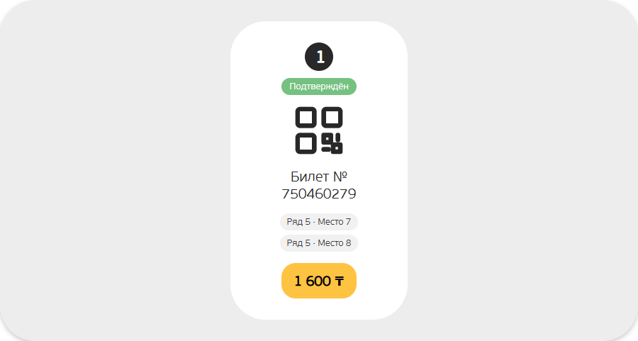 | 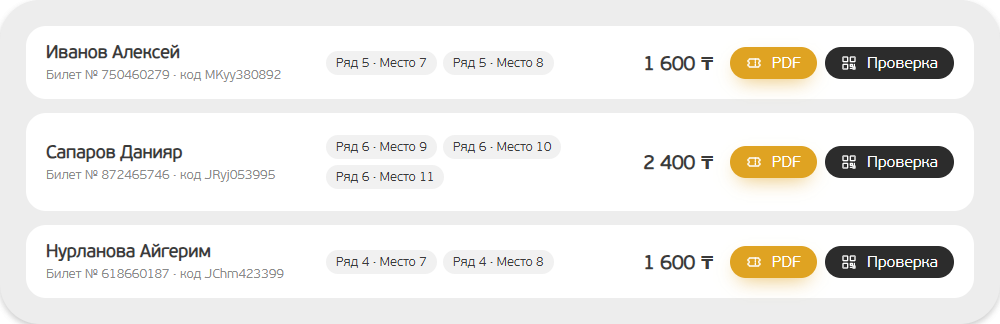 |
| **Mobile: home** | **Mobile: hall map** |
| 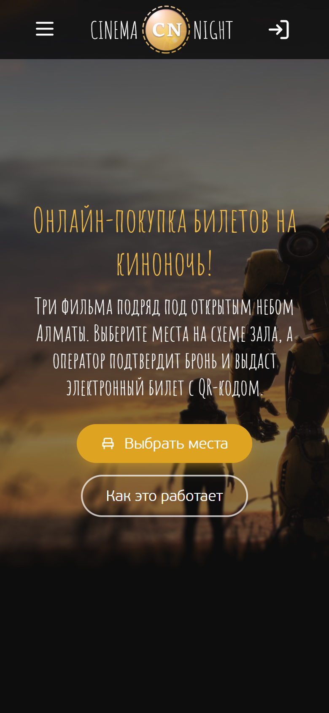 | 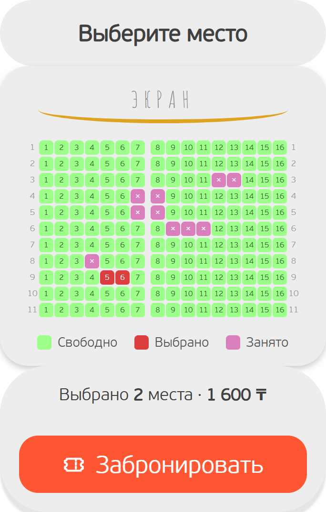 |

</details>

## 🔄 Booking lifecycle

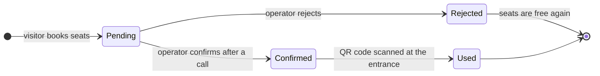

Seats in **Pending**, **Confirmed** and **Used** bookings are shown as taken on
the hall map. The server checks every request again, so a seat can't be sold
twice even if two people click at the same moment.

## 🚀 Quick start

Requirements: **PHP 7.3+** (tested on 8.3) with the `pdo_sqlite` extension, plus
`iconv` or `mbstring` for PDF tickets. You don't need a database server: SQLite
is used by default.

```bash
git clone https://github.com/mredwardlik/cinema-night.git
cd cinema-night

# films, ticket price (800 ₸) and an operator account
php bin/setup.php admin your-password

# start the site → http://localhost:8000
php -S localhost:8000 server.php
```

Sign up as a visitor, fill in your name and phone in the cabinet and book some
seats. Then sign in as `admin` in another browser to confirm the request.

> [!TIP]
> To scan ticket QR codes with a phone, run the server on your local network
> address, for example `php -S 0.0.0.0:8000 server.php`, and open the site by
> the computer's IP. QR codes point to the host the ticket was opened from.

### Apache / shared hosting

Point the document root at the project folder. The bundled `.htaccess` sends all
requests to `index.php` and blocks direct access to `config/`, `storage/`,
`_controllers/` and the other service folders.

### MySQL instead of SQLite

Set the driver in `config/database.php` or with environment variables:

```bash
DB_DRIVER=mysql DB_HOST=localhost DB_NAME=cinema_night DB_USER=root DB_PASSWORD=secret \
php -S localhost:8000 server.php
```

Tables are created automatically by RedBeanPHP on first use.

## ⚙️ Configuration

| File / command                       | What you can change                                                    |
| ------------------------------------ | ---------------------------------------------------------------------- |
| `config/app.php`                     | `debug` (error details), `timezone`, hall layout, max seats per booking |
| `config/database.php`                | `sqlite` / `mysql` driver and connection settings                      |
| `config/routes.php`                  | URL → `controller/action` map                                          |
| `php bin/setup.php --price=1000`     | Ticket price for the whole night                                       |
| `php bin/setup.php <login> <pass>`   | Create an operator, or make an existing user one                       |

> [!IMPORTANT]
> For production set `APP_DEBUG=0` (or `'debug' => false`). Errors are then
> written to `storage/logs/error.log` instead of being shown on the page.

## 🗂 Project structure

```text
cinema-night/
├── index.php              # entry point
├── server.php             # router for PHP's built-in web server
├── bin/setup.php          # first-time setup: films, price, operator account
├── config/                # app, database, routes, CSRF settings
├── _controllers/          # Main, Login, Cabinet, Ticket, Doc
├── _models/               # Booking (statuses, seat checks), Hall (layout)
├── _views/                # PHP templates, PDF ticket, ticket check page
├── template/              # CSS, JS, fonts, images, FPDF + QR code library
├── web/
│   ├── framework/         # the mini-framework: Router, Config, Session, Csrf,
│   │                      # View, Ajax/Post helpers, ErrorHandle, Icons
│   └── rb/rb.php          # RedBeanPHP ORM
└── storage/               # SQLite database and logs (created automatically)
```

## 🛣 Routes

| URL                   | Who       | Description                                       |
| --------------------- | --------- | ------------------------------------------------- |
| `/`                   | everyone  | Landing page: how it works and the film program  |
| `/doc`                | everyone  | Step-by-step instruction                          |
| `/login`              | guests    | Sign in / sign up                                 |
| `/cabinet`            | users     | Profile, hall map, my tickets (operator: panel)   |
| `/ticket{number}`     | owner, operator | PDF ticket                                  |
| `/wipe{number}`       | operator  | Ticket check page opened from the QR code         |

## 🛡 Security

- Passwords are stored with `password_hash()`
- Every POST request is protected by a CSRF token (form field or `X-CSRF-Token`
  header)
- All user data is escaped in templates, and database queries use bound
  parameters
- The session ID is regenerated on sign in. Cookies are `HttpOnly` and
  `SameSite=Lax`
- Service folders aren't reachable from the web
